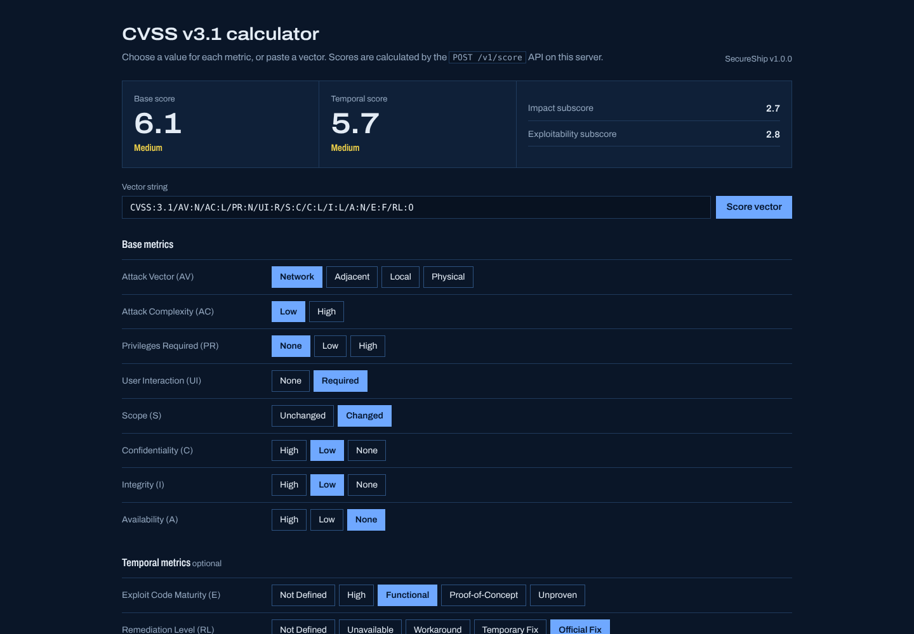
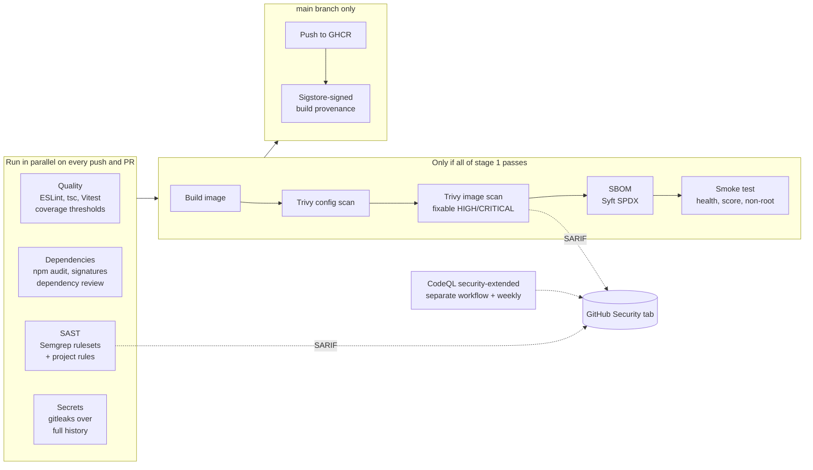

# SecureShip

**A DevSecOps delivery pipeline that actually runs.** SecureShip is a small, useful service (a CVSS v3.1 scoring API with a calculator page). Every commit to it goes through linting, type checking, tests with coverage gates, dependency and signature audits, Semgrep and CodeQL static analysis, full-history secret scanning, Dockerfile and image vulnerability scanning, SBOM generation, a container smoke test, and signed build provenance before anything is published.



> Portfolio demonstration. The service is real and the pipeline is real, but **a passing pipeline isn't proof of security**. [docs/pipeline.md](docs/pipeline.md) explains what each gate can't detect.

## Why this project

Most "DevSecOps" examples are a YAML file with a scanner bolted on. The questions that matter in a real delivery pipeline are harder:

- Which checks **block** a release, and which only **report**?
- What happens when a check fails? Can a broken or vulnerable build still reach users?
- Where do secrets live, and what does the pipeline need access to?
- After a release, can you prove which commit and workflow produced the artifact, and what's inside it?
- What does each tool **miss**?

SecureShip answers each of these in code and documentation.

## The pipeline



Workflow files: [`pipeline.yml`](.github/workflows/pipeline.yml), [`codeql.yml`](.github/workflows/codeql.yml) and [`dependabot.yml`](.github/dependabot.yml). Each control, and its blind spots, is documented in [docs/pipeline.md](docs/pipeline.md).

### Quality gates at a glance

| Gate | Fails the build on |
|---|---|
| ESLint (strict) | Any error |
| TypeScript | Any type error |
| Vitest | Any failing test, or coverage under 90% lines / 85% branches / 90% functions |
| npm audit | A high or critical advisory in production dependencies |
| Semgrep | Any finding from the public rulesets or project rules |
| gitleaks | Any detected secret anywhere in git history |
| Trivy | A high or critical Dockerfile misconfiguration, or a fixable high or critical CVE in the image |
| Smoke test | The container fails to start, returns a wrong score, or doesn't run as `nonroot` |

## The service

A CVSS v3.1 calculator that follows the FIRST specification for base and temporal scores, including the integer-based `Roundup` from Appendix A that avoids floating-point errors.

| Method | Path | Description |
|---|---|---|
| GET | `/` | Calculator page (static HTML and JS; scores come from the API) |
| GET | `/healthz` | `{ "status": "ok", "version": "..." }` |
| GET | `/v1/metrics` | Metric names, values and weights |
| POST | `/v1/score` | `{ "vector": "CVSS:3.1/AV:N/..." }` returns scores, severities, subscores and decoded metrics |
| POST | `/v1/score/batch` | `{ "vectors": [...] }` (up to 100), with per-item results and errors |

```bash
curl -s -X POST localhost:8080/v1/score -H 'content-type: application/json' \
  -d '{"vector":"CVSS:3.1/AV:N/AC:L/PR:N/UI:R/S:C/C:L/I:L/A:N"}'
# {"baseScore":6.1,"baseSeverity":"Medium","impactSubscore":2.7,"exploitabilitySubscore":2.8,...}
```

Error handling: an invalid request shape gets **400**, a well-formed body with an invalid vector gets **422** with a specific reason (for example `Q is not a valid value for Availability (A).`), and a missing or wrong API key gets **401**. Rate limiting returns **429**, and bodies over 16 KB return **413**.

### Security design of the service

- **Strict input validation.** JSON Schema with no type coercion and no silently dropped fields, plus a parser that rejects duplicates, unknown metrics and over-long vectors.
- **No prototype tricks.** Metric lookups use `Object.hasOwn`, so `toString:N` or `__proto__:N` are rejected. A project Semgrep rule enforces this. That rule exists because an early draft of the parser used `key in OBJECT`. It was caught in code review, and the rule and a regression test now stop it coming back.
- **Optional API key** for scoring endpoints, compared in constant time over SHA-256 digests.
- `@fastify/helmet` with a strict CSP (`script-src 'self'`, no inline code), plus rate limiting.
- **No internals in errors.** 5xx responses say "Unexpected server error" and the details go to structured logs, which redact credentials.
- **Fail-fast configuration.** An invalid `PORT`, `LOG_LEVEL`, short `API_KEY` or bad rate limit stops start-up with a clear message.
- **Hardened container.** Multi-stage build, production dependencies only (`--ignore-scripts`), a distroless runtime with no shell or package manager, a `nonroot` user and a health check.

## Run it locally

Requirements: Node.js 22.

```bash
git clone https://github.com/<your-username>/secureship.git
cd secureship
npm ci
npm run dev            # http://localhost:8080
npm test               # 57 tests
npm run ci:local       # the pipeline's code-level gates, in order
```

With Docker:

```bash
docker build -t secureship .
docker run -p 8080:8080 -e API_KEY="$(node -e "console.log(require('crypto').randomBytes(32).toString('base64url'))")" secureship
```

Configuration (see [`.env.example`](.env.example)): `PORT`, `LOG_LEVEL`, `API_KEY` (optional, 24+ characters) and `RATE_LIMIT_PER_MINUTE`.

## Deploy

The pipeline publishes `ghcr.io/<owner>/secureship:<sha>` and `:latest` with signed provenance. To check an image before running it:

```bash
gh attestation verify oci://ghcr.io/<owner>/secureship:latest --owner <owner>
```

For a free public demo, deploy the published image (or the repository's Dockerfile) as a Render web service. Set `API_KEY` only if you want the scoring endpoints private; the calculator page can't send a key. Free instances sleep when idle.

## Verified so far

| Check | Status |
|---|---|
| Lint, type check, 57 tests, coverage thresholds, `npm audit`, project Semgrep rules, build | **Run locally, all passing** (`npm run ci:local`) |
| Workflow syntax | Checked with `actionlint` |
| Container build, Trivy, gitleaks, Syft, CodeQL, `npm audit signatures`, GHCR publish, provenance | **Defined but not yet run.** The build environment used to write this couldn't reach container registries or those tools' download hosts. They run on the first push to GitHub |

## Limitations and next steps

- Pin every GitHub Action to a full commit SHA and the base images to digests (currently version tags, kept current by Dependabot).
- Add DAST (OWASP ZAP baseline scan against the smoke-test container) and property-based fuzzing of the vector parser.
- CVSS v4.0 support, and environmental metrics for v3.1.
- Branch protection that requires the pipeline and CodeQL to pass before merge is a repository setting, and it must be turned on manually.

## License

MIT. See [LICENSE](LICENSE). The CVSS specification is © FIRST.Org, Inc., and this project implements its published formulas.
