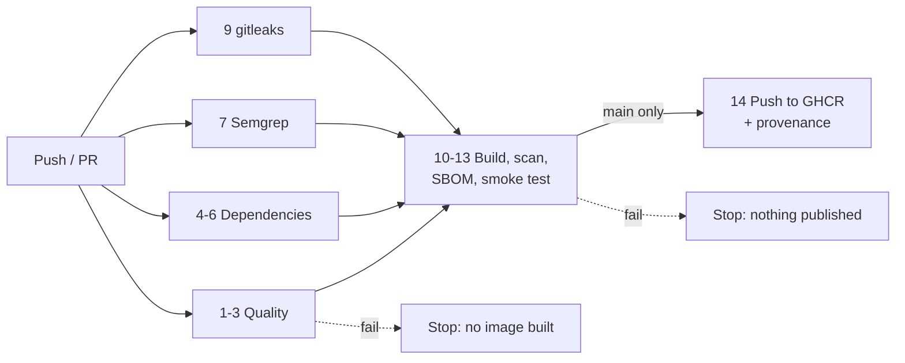

# Pipeline controls: what each one catches and what it misses

A green pipeline means **these specific checks found nothing they know how to find**. It doesn't mean the software is secure. This page is honest about the difference, gate by gate.

| # | Gate | Tool | Blocks the build when | What it can't detect |
|---|---|---|---|---|
| 1 | Lint | ESLint with `typescript-eslint` strict | Code breaks style or correctness rules, such as unused variables, unsafe `any` patterns or dynamic `delete` | Logic errors, and anything that's valid code but wrong behaviour |
| 2 | Type check | `tsc --noEmit` (strict) | Types don't line up | Runtime data that doesn't match its declared type (that's why request bodies also have JSON Schema validation) |
| 3 | Tests and coverage | Vitest, 57 tests | Any test fails, or coverage drops below 90% of lines, 85% of branches or 90% of functions | Untested behaviour. High coverage shows that code *ran*, not that its results were checked. The CVSS tests compare against values computed from the specification's formulas |
| 4 | Dependency audit | `npm audit --omit=dev --audit-level=high` | A production dependency has a known high or critical advisory | Vulnerabilities that haven't been disclosed yet, malicious packages with no advisory, and flaws in our own code |
| 5 | Registry signatures | `npm audit signatures` | An installed package's registry signature or provenance doesn't verify | A package that is correctly signed but malicious, such as a compromised maintainer account |
| 6 | Dependency review | `actions/dependency-review-action` (pull requests) | A PR adds a dependency with a high-severity advisory or a denied licence (GPL-3.0, AGPL-3.0) | The same limits as #4, but applied at the moment a dependency is introduced |
| 7 | SAST | Semgrep: `p/typescript`, `p/nodejsscan`, `p/secrets` and [project rules](../.semgrep/project-rules.yml) | A rule matches, such as `eval`, `child_process`, a non-constant-time secret comparison, or `in` used on a lookup table | Vulnerabilities no rule describes, and data-flow problems across files (CodeQL covers some of these) |
| 8 | SAST (deep) | CodeQL `security-extended` (separate workflow, weekly too) | Results appear in the Security tab. It doesn't block merges by default; that's a branch-protection setting | Business-logic flaws and authorisation design errors |
| 9 | Secret scan | gitleaks, over the **full git history** | A string that looks like a credential is committed anywhere in history | Secrets in unusual formats, secrets outside git (CI variables, chat), and secrets that were committed and then force-pushed away |
| 10 | IaC and Dockerfile | `trivy config` | A Dockerfile or configuration misconfiguration rated high or critical, such as running as root or missing `USER` | Insecure settings at run time (environment variables, host configuration) |
| 11 | Image vulnerabilities | `trivy image --ignore-unfixed --severity HIGH,CRITICAL` | The built image contains an OS or npm package with a **fixable** high or critical CVE | Unfixable CVEs (reported, but they don't block), zero-days, and vulnerabilities in code Trivy can't identify |
| 12 | SBOM | Syft (SPDX JSON), plus BuildKit SBOM on publish | It never blocks. It records exactly what shipped | It's an inventory, not a judgement. It only helps when someone checks it against new advisories later |
| 13 | Smoke test | `docker run` + `curl` | The container doesn't start, the health check fails, `/v1/score` returns the wrong score, or the image user isn't `nonroot` | Anything beyond those paths |
| 14 | Provenance | `actions/attest-build-provenance` (Sigstore) | It never blocks. It signs a statement of which workflow and commit built which image digest | Whether the source code itself is trustworthy. Provenance proves *where* an artifact came from, not that it's *safe* |

## Order and failure handling

- The four first-stage jobs run in parallel. The container job runs only if **all** of them pass, so a failing test or a leaked secret never produces an image.
- Publishing runs only on pushes to `main`, after the image has been scanned and smoke-tested. Pull requests never publish.
- Every job has the least permissions it needs. The default is `contents: read`, and only `publish` can write packages or mint an OIDC token.
- Test results, coverage and the SBOM are uploaded as artifacts even when a job fails, so the failure can be investigated.
- Semgrep and Trivy findings are uploaded as SARIF to GitHub code scanning, so they appear inline on pull requests.

## Secrets

- The service reads its only secret, `API_KEY`, from the environment. Locally that's a git-ignored `.env`. In hosting, it's the platform's secret store.
- The pipeline needs **no custom secrets**. It uses the per-run `GITHUB_TOKEN`, scoped by `permissions:`. Publishing to GHCR uses that token, and provenance signing uses keyless OIDC, so no long-lived signing key exists to leak.
- Request logs redact the `x-api-key` and `authorization` headers.

## Known gaps

- **Actions are pinned by version tag, not commit SHA.** A compromised tag could change what runs. Dependabot is configured to keep the actions current; the stricter step is to pin each `uses:` to a full SHA. This repository can't do that without resolving the SHAs online at publish time, and it's listed as the first improvement.
- **Base images are pinned by tag, not digest**, for the same reason. Dependabot tracks Docker updates.
- **gitleaks-action** is free for personal accounts. An organisation needs a free licence key, set as `GITLEAKS_LICENSE`.
- No DAST (for example OWASP ZAP against the running container) and no fuzzing of the vector parser yet. Both are natural next steps.
